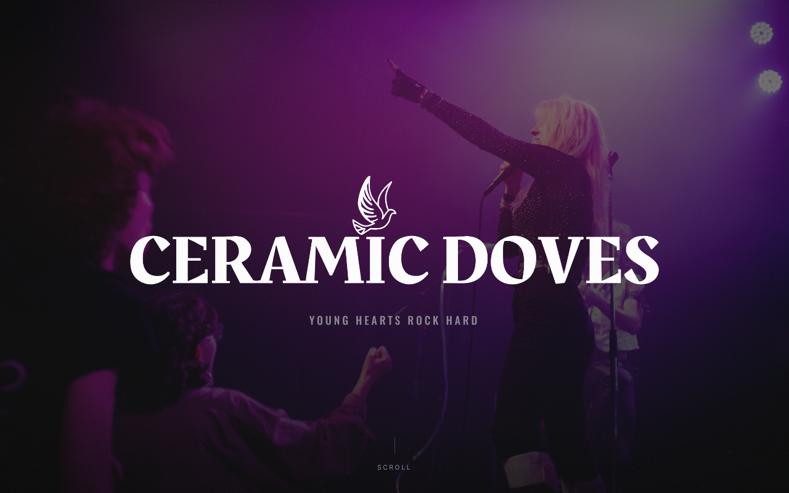

# Ceramic Doves – Band Website

The official website of the young Swiss rock band **Ceramic Doves**, live at
[ceramicdoves.ch](https://ceramicdoves.ch).



A single-page, hand-coded static site – HTML, CSS and vanilla JavaScript,
no framework and no build step, hosted with GitHub Pages.

## Sections

- **Hero** – full-screen, darkened photo slideshow with the band wordmark
- **About** – band bio
- **Listen** – built-in audio player plus links to Spotify and mx3
- **Shows** – upcoming and past concerts
- **Gallery** – live photos
- **Booking** – contact and social links (Instagram, TikTok)

Additional release page: [`sound-of-my-life/`](sound-of-my-life) for the single
*Sound of My Life*.

## Highlights

- Responsive design with a dedicated mobile layout
- Scroll-triggered reveal animations (`IntersectionObserver`)
- Respects `prefers-reduced-motion`
- Clearly marked `✎ EDIT` comments so non-developers in the band can update
  texts, dates and images

## Structure

```
├── index.html             main page (markup, styles and scripts)
├── sound-of-my-life/      single release page
├── images/                photos
├── audio/                 song previews (mp3)
├── logo/                  logo and favicon
├── docs/                  screenshot for this README
└── CNAME                  custom domain for GitHub Pages
```

## Run locally

Open `index.html` in a browser, or run `python -m http.server` in this folder.
